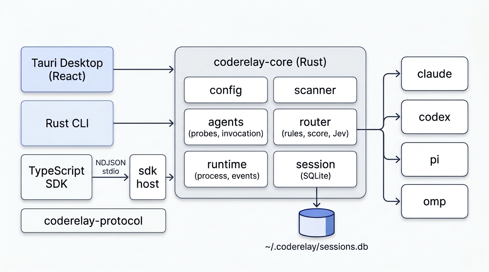

<p align="center">
  
</p>

<h1 align="center">coderelay</h1>

<p align="center">
  <strong>A desktop-first local control plane for coding agents.</strong><br>
  发现本机 Agent，比较模型与能力，选择最合适的执行者，并保留可续跑的共享上下文。
</p>

<p align="center">
  <a href="package.json"></a>
  <a href="https://www.rust-lang.org"></a>
  <a href="https://tauri.app"></a>
  <a href="LICENSE"></a>
  
</p>

---

## 目录

- [为什么需要 coderelay](#为什么需要-coderelay)
- [核心特性](#核心特性)
- [支持的 Agent 矩阵](#支持的-agent-矩阵)
- [快速开始](#快速开始)
  - [桌面端](#桌面端)
  - [Rust CLI](#rust-cli)
  - [TypeScript SDK](#typescript-sdk)
  - [源码运行](#源码运行)
- [使用指南](#使用指南)
  - [CLI 任务路由模式（run）](#cli-任务路由模式run)
  - [环境与规则诊断（doctor / agents / models）](#环境与规则诊断doctor--agents--models)
  - [旧 Bun TUI（迁移兼容）](#旧-bun-tui迁移兼容)
- [决策模式（Routing Modes）](#决策模式routing-modes)
- [配置说明](#配置说明)
- [架构设计](#架构设计)
- [本地开发](#本地开发)
- [开源协议](#开源协议)

---

## 为什么需要 coderelay

当前开发者终端里通常同时安装了多个 Coding Agent：

- **Claude Code**：擅长复杂架构推理、长上下文理解与大型重构。
- **Codex CLI**：擅长工具链调用、标准代码补全与紧凑指令执行。
- **pi / omp**：适合特定轻量任务或垂直模型场景。

**痛点**：每次切换任务都要手动寻找命令、适配命令行参数、人肉权衡模型成本与上下文窗口。

**解决方案**：`coderelay` 是一个桌面优先的本地 Agent 控制平面。Tauri 桌面端、Rust CLI 和 TypeScript SDK 共享同一套 Rust Core，完成 Agent 扫描、模型探测、路由、执行、取消和 SQLite 会话记录。CLI 保留给自动化、诊断和高级用户，不再作为产品主入口。

---

## 核心特性

- 🖥️ **Tauri 2 桌面端**：工作区扫描、Agent 状态、模型选择、路由预览、流式输出、取消和会话历史。
- 🦀 **单一 Rust Core**：桌面端与 CLI 直接链接同一套扫描、路由、执行和 SQLite 实现。
- 🔍 **环境自动发现**：跨平台检测 PATH、npm/Bun/Homebrew 等安装来源，并探测版本与模型目录。
- 🎯 **三模智能路由**：`local` 规则与评分、`manual` 显式指定、`jev` 远程决策。
- 💾 **跨 CLI 会话**：桌面端自动写入 SQLite；续跑会话时把历史上下文安全注入下一位 Agent。
- 🧰 **自动化 CLI**：`run / agents / models / doctor / favorite`，适合脚本、CI 和排障。
- 🔌 **TypeScript SDK**：通过版本化 NDJSON stdio 协议调用本地 host，支持类型化请求和流式事件。
- 🛡️ **受控执行**：前端只能提交领域请求，不能传任意 shell 或 argv；取消会回收整个进程组。

---

## 支持的 Agent 矩阵

`coderelay` 通过专属与通用适配器统一抽象各 CLI 的调用范式：

| Agent | CLI 命令 | 适配机制 | 说明 |
|---|---|---|---|
| **Claude Code** | `claude` | 专属适配器 | 自动注入 `--dangerously-skip-permissions`、模型切换参数与上下文提示 |
| **Codex CLI** | `codex` | 专属适配器 | 支持 `--model`、`--context-window` 及配置级额外参数 |
| **Pi** | `pi` | 通用适配器 | 参数按标准约定传递，自动版本探针 |
| **OMP** | `omp` | 通用适配器 | 参数按标准约定传递，自动版本探针 |

> 提示：运行 `coderelay agents` 可即时查看本机安装与适配状态。

---

## 快速开始

当前主入口是 Tauri 桌面应用。Rust CLI 和 TypeScript SDK 与桌面端共享同一核心实现。

### 桌面端

从 GitHub Release 下载 macOS DMG 或 Windows NSIS 安装包。

macOS 构建目前为未签名版本；仅对可信来源执行本地临时签名：

```bash
xattr -dr com.apple.quarantine /Applications/CodeRelay.app
codesign --force --deep --sign - /Applications/CodeRelay.app
codesign --verify --deep --strict --verbose=2 /Applications/CodeRelay.app
open /Applications/CodeRelay.app
```

### Rust CLI

桌面与 CLI 共享 Rust Core。推荐通过 Cargo 安装：

```bash
cargo install --path crates/coderelay-cli --locked
coderelay agents
coderelay doctor
coderelay run "修复登录鉴权竞态问题"
```

从仓库运行：

```bash
cargo run -p coderelay-cli -- agents --json
cargo run -p coderelay-cli -- doctor --json
```

> npm 包中的 `coderelay`/`cr` 命令仍指向旧 Bun 实现，作为迁移期的回退入口；新的原生 CLI 通过 Cargo 安装。

### TypeScript SDK

```bash
bun add @alkaidstart/coderelay-sdk
```

```ts
import { CoderelayClient } from "@alkaidstart/coderelay-sdk";

const client = new CoderelayClient();
const discovery = await client.discoverAgents({ cwd: process.cwd() });
const run = await client.run({
  workspace: { cwd: process.cwd() },
  request: { prompt: "Fix the failing tests" },
});

for await (const event of run) {
  if (event.kind === "assistant_text") {
    process.stdout.write(event.text);
  }
}

const result = await run.completed;
await client.close();
```

SDK 默认启动 `coderelay sdk`，通过版本化 NDJSON stdio 通信。

### 源码运行

```bash
git clone https://github.com/GeWu-academy/coderelay.git
cd coderelay
bun install

# 默认开发入口：Tauri 桌面端
bun run dev

# Rust CLI
bun run cli agents --json

# 旧 Bun CLI/TUI（迁移兼容，默认不再作为主入口）
bun run legacy:dev
```

---

## 使用指南

### CLI 任务路由模式（run）

```bash
# 智能走完整规则与评分路由
coderelay run "重构 router 模块的评分逻辑，补齐 TypeScript 类型"

# 显式使用 Claude Code 跳过自动路由
coderelay run -a claude "执行全量单元测试并修复所有报错"

# 显式指定模型
coderelay run -m codex:gpt-5-codex "优化 SQL 查询性能"

# 附带上下文信号，帮助路由引擎精确评分
coderelay run \
  --lang typescript \
  --file src/router/scorer.ts \
  --strength long-context \
  --strength reasoning \
  "解析大型 AST 树并提取所有循环依赖"
```

#### `run` 命令参数速查

| 选项 | 简写 | 类型 | 说明 |
|---|---|---|---|
| `--mode <mode>` | `-M` | `local` \| `manual` \| `jev` | 决策模式（默认 `local`） |
| `--agent <id>` | `-a` | string | 显式指定目标 Agent（跳过路由计算） |
| `--model <model>` | `-m` | string | 显式指定目标模型或 `agent:model` |
| `--cwd <path>` | `-C` | string | 指定扫描与执行的工作目录 |
| `--config <path>` | `-c` | string | 指定自定义配置文件路径 |
| `--file <path>` | - | string[] | 任务相关文件路径（可多次传入，供规则匹配） |
| `--lang <language>` | - | string | 代码语言标识（如 `typescript`、`go`） |
| `--strength <type>` | - | string[] | 期望能力：`coding`、`reasoning`、`long-context`、`tool-use`、`fast`、`cheap`、`creative`、`multimodal` |
| `--context-size <tokens>` | - | number | 预估上下文 Token 规模，参与评分模型加权 |
| `--timeout <ms>` | - | number | 超时守护：超时后自动中止目标 Agent 进程 |

### 环境与规则诊断（doctor / agents / models）

```bash
# 全面诊断：配置文件、路由规则、Agent 安装和模型探测
coderelay doctor

# 查看 Agent 安装状态、版本、运行来源和候选路径
coderelay agents

# 查看本机实际探测到的模型目录
coderelay models

# 机器可读输出
coderelay agents --json
coderelay models --json
coderelay doctor --json
```

### 初始化偏好管理（favorite）

设置日常最习惯的默认初始 Agent，配置将保存在本地 SQLite 数据库中：

```bash
# 查看当前偏好
coderelay favorite

# 设置 Claude Code 为偏好
coderelay favorite claude

# 清除偏好
coderelay favorite clear
```

### 旧 Bun TUI（迁移兼容）

旧 Ink TUI 仍保留一个迁移版本，用于对照和回退，但不再新增功能：

```bash
bun run legacy:dev
```

新功能应进入 Rust CLI、Tauri 桌面端或 SDK。

---

## 决策模式（Routing Modes）

| 模式 | 标志 | 机制说明 | 适用场景 |
|---|---|---|---|
| **Local 模式** | `-M local` | **规则优先 + 评分兜底**。<br>按优先级匹配配置中的关键词、正则、语言与文件，无匹配时按 Agent 能力模型与 Token 成本加权计算。 | 日常开发、私密环境、无外部网络调用依赖。 |
| **Jev 模式** | `-M jev` | **AI 意图路由**。<br>调用 Typesafe SystemOne API（`jev-latest` 模型），结合本地安装候选列表与任务意图做出智能决策。 | 复杂模糊意图、需要高阶语义分析的任务分发。 |
| **Manual 模式** | `-M manual` | **直接穿透**。<br>直接校验指定的 Agent 与模型可用性，跳过所有路由算法。 | 确定只想用某一个 CLI 时的精准分发。 |

> **启用 Jev 模式**：在桌面版设置页填写 `TYPESAFE_API_KEY`，密钥会保存到本机 SQLite，后续无需再配置环境变量：
> ```text
> 设置 → TypeSafe API Key → 保存密钥
> ```
> 为兼容已有安装，环境变量和本地配置文件中的 `TYPESAFE_API_KEY` 仍会作为兜底读取。

---

## 配置说明

`coderelay` 会从当前工作目录向上自动递归查找 `.coderelay/config.yaml`（或 `.yml`、`coderelay.config.yaml`）。

所有配置项均有内置默认值且经过 Zod 强类型校验。

```yaml
version: 1
defaultAgent: codex                  # 无法命中特定规则时的兜底 Agent
defaultModel: codex:gpt-5-codex      # 兜底默认模型

# Agent 自定义配置
agents:
  claude:
    enabled: true
    command: /usr/local/bin/claude   # 可选：显式重写二进制文件绝对路径
    extraArgs: ["--dangerously-skip-permissions"]
    env: {}
  codex:
    enabled: true
    models:
      - id: gpt-5-codex
        label: GPT-5 Codex
        strengths: [coding, tool-use]
        cost: 3                      # 成本等级：1 (极低) ~ 5 (极高)
        default: true

# 路由规则与权重
routing:
  strategy: hybrid                   # hybrid (规则+评分) | rules | score
  rules:
    - name: 深度重构与长文本任务
      priority: 10                   # 优先级数值越大越优先匹配
      when:
        minPromptLength: 2000
        keywords: ["refactor", "重构", "架构"]
      use:
        agent: claude
      score: 25                      # 命中时为候选目标增加的分值

    - name: 前端样式与简单脚本
      priority: 5
      when:
        languages: ["css", "html", "bash"]
      use:
        agent: pi
      score: 15

  # 评分权重调整
  weights:
    strength: 1.0                    # 每命中一项 strength 标签的分值
    rule: 1.0                        # 规则 score 的放大乘数
    default: 2.0                     # 默认 agent/model 的加权基础分
    cost: 0.5                        # 成本惩罚系数（cost 越高扣分越多）
    context: 1.0                     # 大请求匹配 long-context 能力的奖励分
```

---

## 架构设计

`coderelay` 遵循清晰的单向数据流与分层管道架构：

<picture>
  <source media="(prefers-color-scheme: dark)" srcset="assets/architecture-dark.png">
  
</picture>

> 💡 **交互式架构图**：在浏览器中打开 [assets/architecture.html](assets/architecture.html)，可在线缩放、按节点筛选依赖、追踪调用链及切换暗黑/浅色主题。

---

## 本地开发

桌面端与 SDK 的前端工具链使用 Bun，核心、CLI 和 Tauri 后端使用 Rust：

```bash
git clone https://github.com/GeWu-academy/coderelay.git
cd coderelay
bun install

# 默认开发入口：Tauri 桌面端
bun run dev

# Rust CLI
bun run cli agents --json

# SDK
bun run sdk:test
bun run sdk:build

# 全量检查
bun run version:check
cargo fmt --all -- --check
cargo clippy --workspace --all-targets -- -D warnings
cargo test --workspace
bun test
bun run typecheck
bun run desktop:typecheck
bun run sdk:typecheck
bun run --cwd apps/desktop build
```

旧 Bun TUI 仍可运行：

```bash
bun run legacy:dev
```

---

## 开源协议

本项目采用 [MIT License](LICENSE) 授权许可。
