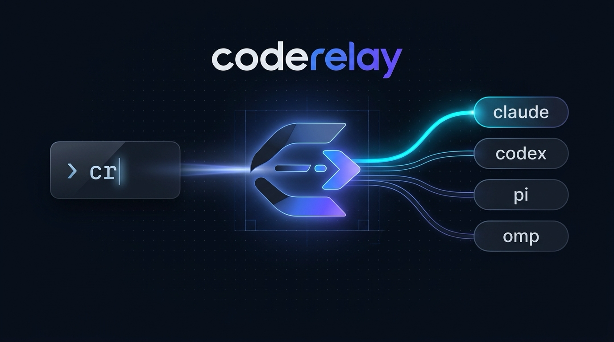

<p align="center">
  
</p>

<h1 align="center">coderelay</h1>

<p align="center">
  <strong>A desktop-first local control plane for coding agents.</strong><br>
  发现本机 Agent，比较模型与能力，选择最合适的执行者，并保留可续跑的共享上下文。
</p>

<p align="center">
  <a href="package.json"></a>
  <a href="https://www.rust-lang.org"></a>
  <a href="https://tauri.app"></a>
  <a href="LICENSE"></a>
  
</p>

<p align="center">
  
</p>

---

## 目录

- [简介](#简介)
- [核心特性](#核心特性)
- [支持的 Agent](#支持的-agent)
- [安装](#安装)
- [桌面端](#桌面端)
- [CLI](#cli)
- [TypeScript SDK](#typescript-sdk)
- [路由模式](#路由模式)
- [配置](#配置)
- [数据与隐私](#数据与隐私)
- [架构](#架构)
- [项目结构](#项目结构)
- [本地开发](#本地开发)
- [开源协议](#开源协议)

---

## 简介

开发机上往往同时装着多个 Coding Agent（Claude Code、Codex CLI、pi、omp……），它们各有擅长的任务、模型与成本。每次换任务都要自己想该用哪个、怎么传参、上一个 Agent 做到哪了。

`coderelay` 把这些工作收敛到一个本地控制平面：

1. **发现**：扫描本机已安装的 Agent CLI，探测版本与可用模型。
2. **路由**：按规则、评分或远程决策选出最合适的 `agent:model`。
3. **执行**：以受控方式启动 Agent，流式回传输出，支持取消（回收整个进程组）和超时。
4. **接力**：会话写入本地 SQLite，续跑时把历史上下文注入下一位 Agent。

Tauri 桌面端、Rust CLI 与 TypeScript SDK 共用同一套 Rust Core。**桌面端是主入口**，CLI 面向自动化、诊断与高级用户。

---

## 核心特性

- 🖥️ **桌面端**：工作区选择、Agent 状态、模型选择、路由预览、流式对话、取消、会话历史。
- 🦀 **单一 Rust Core**：桌面端、CLI、SDK host 共享扫描、路由、执行与会话存储实现。
- 🔍 **环境自动发现**：检测 PATH、npm / Bun / Homebrew 等来源（含 WSL），探测版本与模型目录。
- 🎯 **三种路由模式**：`local`（规则 + 评分）、`manual`（显式指定）、`jev`（远程意图决策）。
- 💾 **跨 Agent 会话**：SQLite 持久化，续跑时安全注入历史上下文。
- 🔌 **TypeScript SDK**：通过版本化 NDJSON stdio 协议调用本地 host，类型化请求与流式事件。
- 🛡️ **受控执行**：调用方只能提交领域请求，不能传任意 shell 或 argv。
- 🎨 **个性化外观**：主题预设、浅色/深色、自定义背景图与不透明度。

---

## 支持的 Agent

| Agent | 命令 | 非交互调用方式 | 续跑 |
|---|---|---|---|
| **Claude Code** | `claude` | `claude -p [--model <m>] <prompt>` | `--resume <id>` |
| **Codex CLI** | `codex` | `codex exec [--model <m>] <prompt>` | `exec resume <id>` |
| **Pi** | `pi` | `pi -p [--model <m>] <prompt>` | `--session <id>` |
| **OMP** | `omp` | `omp -p --mode json [--model <m>] <prompt>` | `--resume <id>` |

运行 `coderelay agents` 可查看本机安装状态、版本、来源与候选路径。可在配置中通过 `agents.<id>.command` 覆盖二进制路径，用 `extraArgs` / `env` 追加参数与环境变量。

---

## 安装

### 桌面端

从 [GitHub Releases](https://github.com/GeWu-academy/coderelay/releases) 下载对应平台安装包：

| 平台 | 安装包 |
|---|---|
| macOS（Universal） | `.dmg` |
| Windows | `.exe`（NSIS） |
| Linux | `.deb` / `.AppImage` |

macOS 构建目前未签名。仅对可信来源执行本地临时签名：

```bash
xattr -dr com.apple.quarantine /Applications/CodeRelay.app
codesign --force --deep --sign - /Applications/CodeRelay.app
open /Applications/CodeRelay.app
```

### CLI

```bash
cargo install --path crates/coderelay-cli --locked
coderelay doctor
```

> npm 包 `@alkaidstart/coderelay` 中的 `coderelay` / `cr` 命令仍指向旧 Bun 实现，仅作迁移期回退；原生 CLI 通过 Cargo 安装。

### 源码运行

需要 [Bun](https://bun.sh) 与 Rust（见 `rust-toolchain.toml`）。

```bash
git clone https://github.com/GeWu-academy/coderelay.git
cd coderelay
bun install
bun run dev        # 启动 Tauri 桌面端
```

---

## 桌面端

| 模块 | 说明 |
|---|---|
| **工作区** | 系统对话框选择目录，下拉合并展示最近工作区；切换后自动重新扫描。 |
| **对话** | 输入任务后实时预览路由结果（Agent / 模型），流式展示输出，可随时取消。 |
| **会话历史** | 侧边栏按工作区列出历史会话；续跑时把上下文注入下一位 Agent。 |
| **Agent 与模型** | 查看安装状态、版本、来源与探测到的模型；手动指定模型或设置偏好 Agent。 |
| **API Key** | 在设置页保存 `TYPESAFE_API_KEY`（Jev 模式使用），存于本机 SQLite。 |
| **配置** | 查看当前生效的配置与路由规则。 |
| **外观** | 主题预设、浅色/深色、自定义背景图与不透明度，设置持久化保存。 |

---

## CLI

```bash
coderelay agents              # Agent 安装与发现状态
coderelay models              # 探测到的模型，按 Agent 分组
coderelay doctor              # 诊断配置、路由规则、Agent 与模型
coderelay favorite [agent]    # 查看 / 设置 / 清除（clear|none）偏好 Agent
coderelay run "<prompt>"      # 路由并执行
```

`agents` / `models` / `doctor` 均支持 `--json` 输出稳定的机器可读结果，适合脚本与 CI。

### `run` 示例

```bash
# 走完整规则 + 评分路由
coderelay run "重构 router 模块的评分逻辑，补齐 TypeScript 类型"

# 指定 Agent，跳过路由
coderelay run -a claude "执行全量单元测试并修复所有报错"

# 指定模型（agent:model）
coderelay run -m codex:gpt-5-codex "优化 SQL 查询性能"

# 提供上下文信号，帮助路由评分
coderelay run \
  --language typescript \
  --file src/router/scorer.ts \
  --strength long-context --strength reasoning \
  "解析大型 AST 并提取所有循环依赖"
```

### `run` 选项

| 选项 | 简写 | 说明 |
|---|---|---|
| `--mode <mode>` | `-M` | 路由模式：`local` \| `manual` \| `jev` |
| `--agent <id>` | `-a` | 指定 Agent，跳过路由 |
| `--model <model>` | `-m` | 指定模型，或 `agent:model` |
| `--cwd <path>` | `-C` | 配置发现与进程执行的工作目录 |
| `--config <path>` | `-c` | 显式配置文件 |
| `--file <path>` | | 任务相关文件，可重复，供规则匹配 |
| `--language <lang>` | | 代码语言，如 `typescript`、`go` |
| `--strength <type>` | | 期望能力，可重复：`coding` `reasoning` `long-context` `tool-use` `fast` `cheap` `creative` `multimodal` |
| `--context-size <tokens>` | | 预估上下文 token 数，参与评分 |
| `--timeout <ms>` | | 超时后终止 Agent 进程 |

---

## TypeScript SDK

```bash
bun add @alkaidstart/coderelay-sdk
```

```ts
import { CoderelayClient } from "@alkaidstart/coderelay-sdk";

const client = new CoderelayClient();
const discovery = await client.discoverAgents({ cwd: process.cwd() });
const catalog = await client.getModelCatalog({ cwd: process.cwd() });

const run = await client.run({
  workspace: { cwd: process.cwd() },
  request: { prompt: "Fix the failing tests" },
});

for await (const event of run) {
  if (event.kind === "assistant_text") process.stdout.write(event.text);
}

const result = await run.completed;
await client.close();
```

SDK 默认启动 `coderelay sdk`（需先安装原生 CLI 并在 PATH 中），通过版本化 NDJSON stdio 通信；host 只接受经过校验的领域请求。更多说明见 [packages/sdk-ts/README.md](packages/sdk-ts/README.md)。

---

## 路由模式

| 模式 | 标志 | 机制 | 适用场景 |
|---|---|---|---|
| **Local** | `-M local` | 规则优先、评分兜底：按优先级匹配关键词、正则、语言与文件；无命中时按能力标签、成本、上下文与默认值加权评分。 | 日常开发、离线或私密环境。 |
| **Jev** | `-M jev` | 调用 Typesafe SystemOne API（`jev-latest`），结合本机已安装候选与任务意图决策。 | 意图模糊、需要语义判断的任务。 |
| **Manual** | `-M manual` | 校验指定 Agent / 模型可用后直接执行，跳过路由。 | 明确知道要用哪个 Agent。 |

**启用 Jev**：在桌面端「设置 → API Key」保存 `TYPESAFE_API_KEY`（密钥来源见 [env.example](env.example)）。环境变量与配置文件中的同名值仍作为兜底读取。

---

## 配置

配置为 YAML，所有字段均有默认值并在加载时校验（未知键会被忽略）。查找顺序：

1. 从工作目录向上逐级查找 `.coderelay/config.yaml`、`.coderelay/config.yml`、`coderelay.config.yaml`、`coderelay.config.yml`；
2. 全局 `~/.coderelay/config.yaml`（可用 `CODERELAY_HOME` 改变位置）；
3. 也可用 `--config` 显式指定。

```yaml
version: 1
defaultAgent: codex                  # 无规则命中时的兜底 Agent
defaultModel: codex:gpt-5-codex      # 兜底模型

agents:
  claude:
    enabled: true
    command: /usr/local/bin/claude   # 可选：覆盖二进制路径
    extraArgs: []                    # 追加到调用参数
    env: {}
  codex:
    enabled: true
    models:
      - id: gpt-5-codex
        label: GPT-5 Codex
        strengths: [coding, tool-use]
        cost: 3                      # 1（极低）~ 5（极高）
        default: true

routing:
  strategy: hybrid                   # hybrid | rules | score
  rules:
    - name: 深度重构与长文本任务
      priority: 10                   # 数值越大越先匹配
      when:
        minPromptLength: 2000        # 另有 maxPromptLength / patterns / files
        keywords: ["refactor", "重构", "架构"]
      use:
        agent: claude
      score: 25                      # 命中时为候选增加的分值（默认 10）
    - name: 前端样式与简单脚本
      priority: 5
      when:
        languages: ["css", "html", "bash"]
      use:
        agent: pi
      score: 15
  weights:
    strength: 1.0                    # 命中一项 strength 的分值
    rule: 1.0                        # 规则 score 的放大系数
    default: 2.0                     # 默认 agent / model 的基础加分
    cost: 0.5                        # 成本惩罚系数
    context: 1.0                     # 大请求命中 long-context 的奖励
```

运行 `coderelay doctor` 可校验当前配置并查看实际生效的规则。

---

## 数据与隐私

- 会话历史、偏好与 API Key 保存在本机 `~/.coderelay/sessions.db`（SQLite）。
- 除 Jev 模式会把任务意图与本机候选列表发送到 Typesafe API 外，其余路由与执行均在本机完成。
- 执行时仅启动已安装的 Agent CLI；桌面端与 SDK 不能提交任意 shell 命令。

---

## 架构

<picture>
  <source media="(prefers-color-scheme: dark)" srcset="assets/architecture-dark.png">
  
</picture>

详细说明见 [docs/architecture.md](docs/architecture.md)，迁移背景见 [docs/plans/2026-11-04-rust-tauri-migration.md](docs/plans/2026-11-04-rust-tauri-migration.md)。

---

## 项目结构

```text
coderelay/
├── apps/desktop/            # Tauri 2 桌面端（React 前端 + src-tauri 后端）
├── crates/
│   ├── coderelay-core/      # 扫描、路由、执行、会话存储
│   ├── coderelay-protocol/  # 版本化 NDJSON 协议类型
│   └── coderelay-cli/       # Rust CLI 与 SDK host
├── packages/sdk-ts/         # TypeScript SDK
├── src/                     # 旧 Bun CLI/TUI（迁移兼容，不再新增功能）
├── docs/                    # 设计与迁移文档
├── assets/                  # Logo、产品图、架构图
└── .github/workflows/       # ci / desktop-build / release
```

---

## 本地开发

```bash
bun install
bun run dev              # Tauri 桌面端
bun run cli agents --json  # 运行 Rust CLI
bun run sdk:build        # 构建 SDK

# 全量检查
bun run check
```

`bun run check` 依次执行版本一致性检查、类型检查、Bun 测试、SDK 类型检查与测试，以及 `cargo fmt` / `clippy` / `test`。桌面端另可用 `bun run desktop:typecheck` 检查。

旧 Bun TUI 仍可通过 `bun run legacy:dev` 运行，仅用于对照与回退。

---

## 开源协议

本项目采用 [MIT License](LICENSE) 授权许可。
