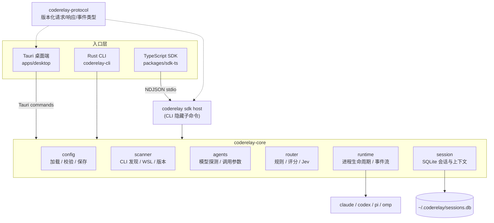
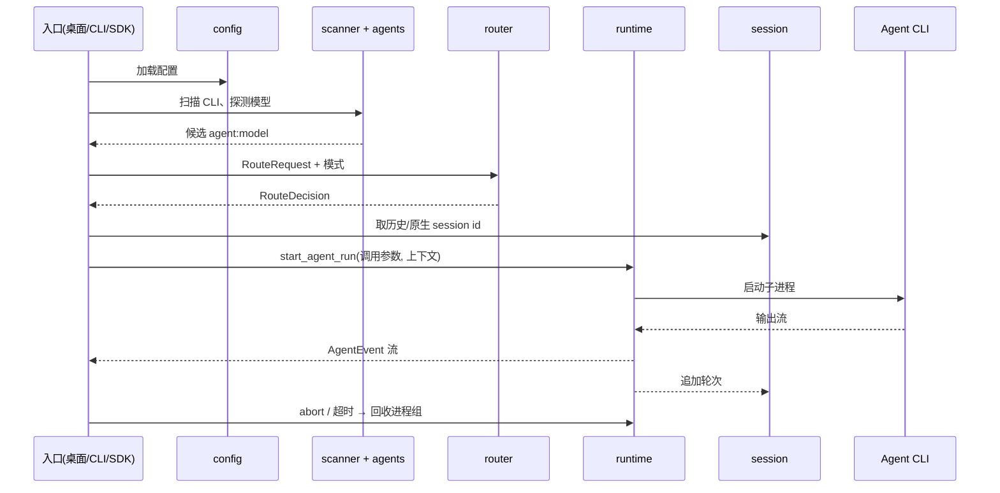

# coderelay 架构文档

> 版本：v0.4.x（2026-11-04 依据当前 Rust workspace 与 Tauri 桌面端整理）
>
> 一句话：coderelay 是桌面优先的本地编码 Agent 控制平面——扫描本机已安装的 Agent CLI（claude / codex / pi / omp），按规则、评分或远程决策选出 `agent:model`，受控地启动它，并把会话写入 SQLite 以便跨 Agent 续跑。

> [!NOTE]
> 本文取代 v0.2.0 的 Bun/Ink 实现文档。旧实现仍保留在 `src/`（`bun run legacy:dev`），仅用于迁移期对照，不再新增功能。迁移背景见 [plans/2026-11-04-rust-tauri-migration.md](plans/2026-11-04-rust-tauri-migration.md)。

---

## 1. 总览

三个入口共享同一个 `coderelay-core`，不存在各自独立的路由或执行逻辑。

---

## 2. Workspace 与 crate 划分

| 位置 | 职责 |
|---|---|
| `crates/coderelay-core` | 平台无关的领域核心，不依赖 Tauri 或终端框架；文件系统、进程执行通过 `Host` trait 注入。 |
| `crates/coderelay-protocol` | `PROTOCOL_VERSION = 1` 的 NDJSON 信封、方法名常量、错误码与各方法参数/结果类型。 |
| `crates/coderelay-cli` | clap 命令（`run / agents / models / doctor / favorite`）与隐藏的 `sdk` host；含 Jev 客户端 `jev.rs`。 |
| `apps/desktop` | React + Zustand 前端；`src-tauri` 以 Tauri commands 封装 core。 |
| `packages/sdk-ts` | `CoderelayClient`，拉起 `coderelay sdk` 子进程并解析事件流。 |

---

## 3. coderelay-core 模块

### 3.1 `config`
- YAML 配置，`version: 1`，字段均有默认值，已知字段加载时校验，未知键忽略。
- 查找顺序：从 cwd 向上查 `.coderelay/config.{yaml,yml}`、`coderelay.config.{yaml,yml}` → 全局 `~/.coderelay/config.{yaml,yml}`（`CODERELAY_HOME` 可改位置）；`--config` 显式指定优先。
- 提供 `load_config`、`save_config_source`（桌面端配置页写回）与 `render_default_config_yaml`。

### 3.2 `scanner`
- `scan_coding_clis` 按 PATH 与 npm / Bun / Homebrew 等来源收集候选路径，探测 `--version`，产出 `DetectedCli` 与诊断信息。
- `scan_wsl_clis` 处理 Windows 下 WSL 内的 Agent；`LaunchTarget` 区分直接启动与经 WSL 启动。

### 3.3 `agents`
- `probes`：各 Agent 的模型探测（`ClaudeModelProbe`、`CodexModelProbe`、`PiModelProbe`、`OmpModelProbe`），汇总为 `ModelCatalog`。
- `catalog`：把探测结果与配置合并为路由候选（`to_route_candidates`），并校验显式指定的 `agent:model`。
- `invocation`：`build_prompt_args` 按 Agent 生成非交互调用参数与续跑参数：

| Agent | 调用 | 续跑 |
|---|---|---|
| claude | `-p [--model m] [extraArgs] <prompt>` | `--resume <id>` |
| codex | `exec [--model m] [extraArgs] [resume <id>] <prompt>` | `resume <id>` |
| pi | `-p [--model m] [extraArgs] <prompt>` | `--session <id>` |
| omp | `-p --mode json [--model m] [extraArgs] <prompt>` | `--resume <id>` |

### 3.4 `router`
- 输入 `RouteRequest`（prompt、files、language、contextSize、requiredStrengths），输出 `RouteDecision`。
- 三种模式（`RoutingMode`）：
  - `local`：按 `routing.strategy` 走 `rules`（规则优先）、`score`（仅评分）或 `hybrid`（规则分数计入评分）。
  - `manual`：只校验显式 Agent/模型，不路由。
  - `jev`：`coderelay-cli/src/jev.rs` 调用 Typesafe SystemOne API（`jev-latest`），把本机候选与任务意图交给远程决策。
- 评分权重：`strength / rule / default / cost / context`；`ModelStrength` 合法值只来自 `MODEL_STRENGTHS`，不在业务代码重复维护。
- `has_ambiguous_route` 用于判断候选评分是否存在歧义。

### 3.5 `runtime`
- `start_agent_run` 是 prompt 执行的唯一出口，返回 `AgentRunHandle`（事件流 + `abort`）。
- 以 tokio 启动子进程，Unix 下独立进程组、`kill_on_drop`；取消或超时时回收整个进程组，Windows 下终止进程树。
- 输出经 `ChunkParser` 解析，按 `AgentProtocol`（结构化 JSON 或纯文本）产出 `AgentEvent`（含 `SessionStarted`、助手文本等）。
- 结果为 `AgentRunResult`：状态（completed / failed / timeout / aborted / spawn-error）、退出码、信号、耗时、文本与 stderr 尾部。

### 3.6 `session`
- `SessionStore`（rusqlite，bundled）保存会话、轮次（`SessionTurn`）、最近工作区与偏好；默认路径 `~/.coderelay/sessions.db`。
- 每个轮次记录 Agent、prompt、输出、退出码、状态、上下文来源（`native` / `transcript` / `none`）与协议。
- 续跑：同一 Agent 且有原生 session id 时用原生续跑；换 Agent 时由 `build_prompt_with_context` 把历史对话作为上下文注入下一个 prompt。
- 同一数据库还保存偏好 Agent 与 Jev API Key。

---

## 4. 入口层

### 4.1 桌面端
前端只能调用下列 Tauri commands，不能传 shell 或 argv：

`runtime_status` · `supported_agents` · `discover` · `route_preview` · `start_run` · `cancel_run` · `list_recent_workspaces` · `pick_workspace` · `list_sessions` · `get_session` · `delete_session` · `delete_workspace_sessions` · `get_jev_settings` · `save_jev_api_key` · `clear_jev_api_key` · `read_config_source` · `save_config`

前端状态由 Zustand 管理（`navigationStore` 路由/视图、`themeStore` 主题与背景图），视图包括工作区、对话、会话、API Key、配置。

### 4.2 CLI
`run / agents / models / doctor / favorite`，其中 `agents / models / doctor / favorite` 支持 `--json`。详见 README。

### 4.3 SDK host
`coderelay sdk` 在 stdio 上收发 NDJSON：请求带协议版本，响应与运行事件分开传递，完成时发 `RunCompletedEnvelope`。方法：`status`、`discoverAgents`、`getModelCatalog`、`route`、`startRun`、`cancelRun`、`listRecentWorkspaces`、`listSessions`、`getSession`、`readConfig`、`saveConfig`。

---

## 5. 一次 `run` 的数据流

---

## 6. 安全边界

- 入口只提交领域请求（prompt、工作区、agent/model、路由信号），调用参数仅由 `build_prompt_args` 生成。
- 仅启动已扫描到或配置显式指定的 Agent 可执行文件。
- 取消与超时回收整个进程组/进程树，避免遗留子进程。
- 仅 Jev 模式会联网，且只发送任务意图与本机候选列表；API Key 存本机 SQLite，环境变量与配置文件作为兜底。

---

## 7. 测试与发布

- Rust：`cargo fmt --all -- --check`、`cargo clippy --workspace --all-targets -- -D warnings`、`cargo test --workspace`。
- 前端与 SDK：`bun test`、`bun run typecheck`、`bun run desktop:typecheck`、`bun run sdk:test`。
- 汇总：`bun run check`（含 `version:check`，要求各处版本一致）。
- CI：`.github/workflows/ci.yml` 校验；`desktop-build.yml` 构建 macOS Universal DMG、Windows NSIS、Linux deb/AppImage；`release.yml` 在 `package.json` 版本变化或 `v*` tag 时发布。

---

## 8. 已知简化与扩展点

- `assets/architecture.html`（交互式架构图）仍是旧 Bun 实现的内容，待按本文重绘；`architecture-light/dark.png` 已更新。
- 新增 Agent：在 `agent.rs` 注册 id、`agents/probes.rs` 增加探测、`agents/invocation.rs` 增加调用参数分支，并补测试（需覆盖非空 `strengths`/`cost` 等元数据透传）。
- 版本号目前在 Cargo workspace、`package.json`、SDK 之间存在不一致，需统一后再发布。
</Content>
